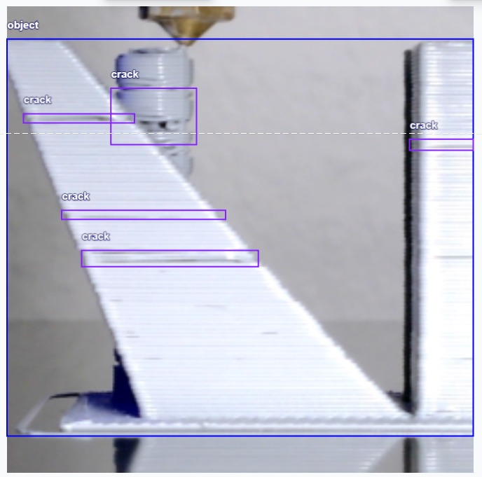
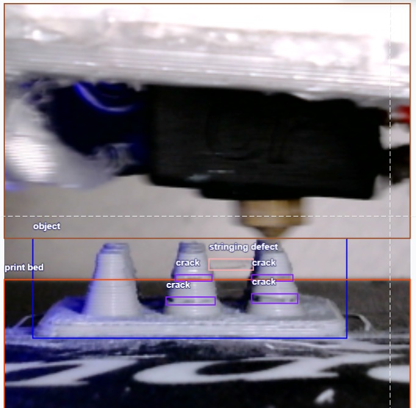
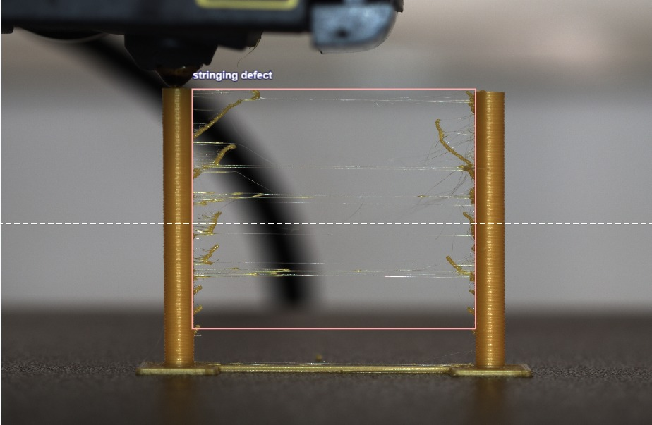

# PrintVision AI

**3D-print defect detection and process-parameter optimisation with YOLOv8 and Gaussian processes.**

PrintVision AI looks at a photo of a 3D-printed part, finds defects such as cracks and stringing, and turns them into a single quality score. It then uses those scores from a small set of temperature-tower prints to find the best nozzle temperature and print speed, and the temperature range that gives defect-free parts, with very few test prints.

---

## The problem

FDM print quality depends heavily on process settings, nozzle temperature in particular. The usual way to tune them is trial and error: print, inspect by eye, adjust, and print again. That wastes filament and time, and the judgement is subjective. We wanted:

1. **Objective inspection**: detect and locate defects automatically from a photo.
2. **A number, not just boxes**: one defect score per print, so settings can be compared.
3. **Sample-efficient tuning**: recommend the best setting and a safe operating window from only a handful of prints.

## Approach

```
Photo ──► YOLOv8n detector ──► defect boxes ──► defect score ──► Gaussian-process model ──► best setting + acceptable range
```

### 1. Defect detection
- **Model:** YOLOv8n (Ultralytics), trained on a custom Roboflow dataset.
- **6 classes:** `crack`, `failed print`, `object`, `print bed`, `printer head`, `stringing defect`.
- Only the defect classes (crack, failed print, stringing) are shown and scored. `object`, `print bed` and `printer head` give context only.

### 2. Print quality score
For each image, the size and the number of each defect are combined:

```
score = Σ_defect  weight_defect × ( area_weight × defect_area_fraction + count_weight × defect_count )
```

- Defect area is the confidence-weighted box area divided by the image area.
- **Cracks and stringing are weighted higher**, because they matter most for part quality.
- A confident `failed print` detection is a penalty score, never zero.
- Lower is better. Photos of the same setting are averaged.

### 3. Process-parameter optimisation
- Temperature-tower prints at **nozzle temperature 215–235 °C** and **print speeds 1X and 2X**.
- For each speed, a **Gaussian-process regressor** (Matérn kernel + noise) is fitted to score versus temperature.
- From the fit:
  - **Best setting:** the temperature with the lowest predicted defect score.
  - **Defect-free / acceptable range:** temperatures where the upper confidence bound stays below the acceptable-score threshold.
  - **Next print to try:** chosen by Expected Improvement, so each extra print gives the most information.

## Results

| Metric | Value |
|---|---|
| Detector | YOLOv8n, 6 classes |
| Best F1 score | **0.74** |
| at confidence threshold | **0.358** |

The optimisation step returns the best tested temperature/speed and a predicted acceptable temperature range from only a few temperature-tower photos. Sample input photos are in [`assets/temperature_tower/`](assets/temperature_tower/).

| 215 °C, 1X | 225 °C, 2X | 235 °C, 1X |
|---|---|---|
|  |  |  |

## Streamlit app

The app (`app.py`) has two tabs:

| Tab | What it does |
|---|---|
| **Single image inspection** | Upload one photo, run YOLO, see the annotated defects, a detection table, the defect score and a CSV download. |
| **Batch scoring & optimisation** | Upload a set of photos named `T<temp>_v<speed>` (e.g. `T225_v1_a1.jpg` = 225 °C at 1X), score every print, fit the GP per speed, and see the best setting, acceptable range, suggested next print and a score-vs-temperature chart. |

Scoring weights, confidence thresholds, the acceptable-score threshold and the planned temperature window can all be changed in the sidebar.

## Repository structure

```
.
├── app.py                               # Streamlit app (inspection + batch optimisation)
├── scripts/
│   └── scoring_and_optimisation.py      # Stand-alone scoring + GP optimisation script
├── notebooks/
│   ├── training_and_documentation.py    # Original Colab notebook export: dataset, training, export
│   └── retrain_colab.ipynb              # Retrain + compare against the current model (Colab GPU)
├── assets/temperature_tower/            # Sample temperature-tower photos
├── requirements.txt
└── README.md
```

## Getting started

### 1. Install

```bash
git clone https://github.com/ameeniszath/printvision-ai.git
cd printvision-ai
python -m venv .venv
# Windows: .venv\Scripts\activate    macOS/Linux: source .venv/bin/activate
pip install -r requirements.txt
```

### 2. Model weights

The trained weights are not stored in this repository.

> **Download `best.pt`:** _<Google Drive link — to be added>_

Put the file at `weights/best.pt`, or set the environment variable `PRINTVISION_WEIGHTS` to its full path. You can also paste the path into the app's sidebar.

### 3. Run the app

```bash
streamlit run app.py
```

### 4. (Optional) Run the scoring script

```bash
python scripts/scoring_and_optimisation.py
```

By default it reads photos from `assets/temperature_tower/`. Set `PRINTVISION_PHOTOS` to use another folder.

### Training

- `notebooks/training_and_documentation.py` is the original Colab notebook used for training. It reads the Roboflow API key from the `ROBOFLOW_API_KEY` environment variable or asks for it at runtime.
- `notebooks/retrain_colab.ipynb` retrains the detector on a Colab GPU and compares it with the current `best.pt` on the same test split (F1 at its best confidence, mAP50, mAP50-95, precision, recall). It saves the result as `best_v2.pt` and never overwrites the current model. The API key comes from Colab Secrets.

## Limitations

- The model was trained on a modest custom dataset, so lighting, camera angle and background affect detections.
- An empty result does not prove a part is defect-free.
- The optimisation result depends on the scoring weights and threshold chosen, and on the small number of test prints.

## Credits

**IIT Madras course project, Team 3:**
[Ameen](https://github.com/ameeniszath) · <Teammate 1> · <Teammate 2> · <Teammate 3>

Built with [Ultralytics YOLOv8](https://github.com/ultralytics/ultralytics), [Roboflow](https://roboflow.com), [scikit-learn](https://scikit-learn.org) and [Streamlit](https://streamlit.io).
