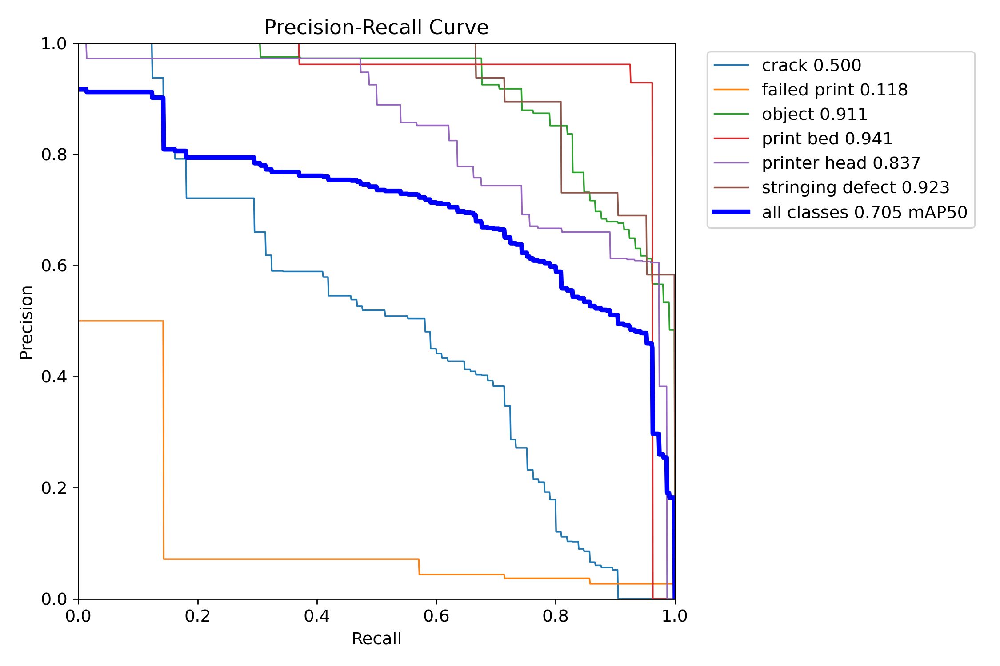
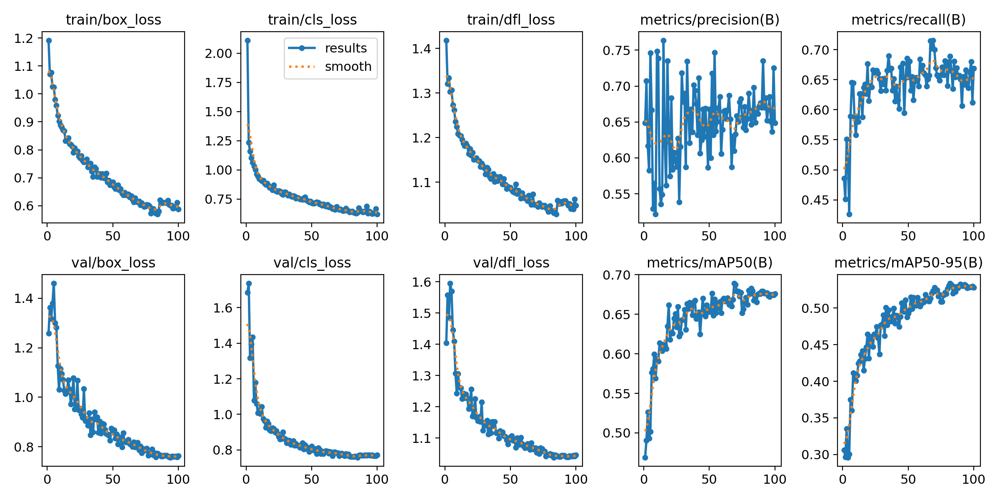
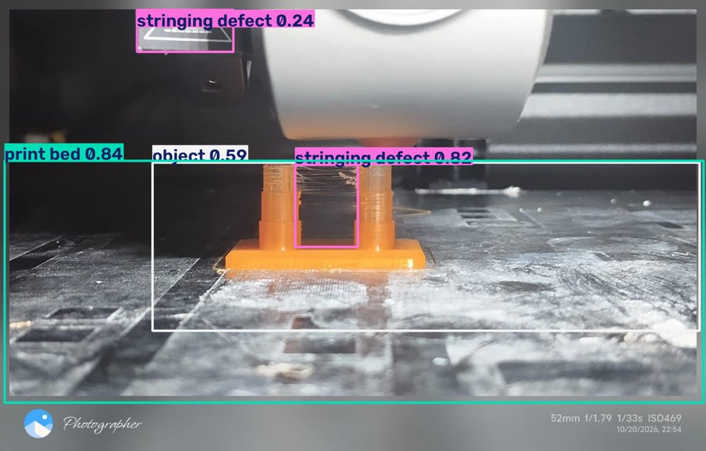

# PrintVision AI

**AI-driven visual defect detection and process-parameter optimisation for FDM 3D printing.**

PrintVision AI inspects a photo of a 3D-printed part, finds defects such as cracks, stringing and failed prints with a YOLOv8 detector, and turns them into one quality score. It then uses those scores from a few temperature-tower prints and a **Gaussian-process (Bayesian) model** to recommend the best nozzle temperature and print speed, and the window of temperatures that gives defect-free parts, with only a handful of test prints.

> Developed by **Ameen** (project lead) with **A. Abilesh**: course project for *ME6324 AI in Manufacturing*, IIT Madras (2026).

---

## Problem

FDM print quality depends heavily on process settings, nozzle temperature in particular. Too cold and layers don't fuse, so cracks appear. Too hot and the nozzle oozes, so stringing appears. The usual way to tune settings is trial and error: print, inspect by eye, adjust, and print again. That is slow, subjective and wastes filament.

**Goals**
1. Detect and localise defects automatically from a photo.
2. Convert detections into a single, comparable **defect score** per print.
3. Find the best setting and a safe operating window with **as few test prints as possible**.

## Approach

```
Photo ─► YOLOv8 detector ─► defect boxes ─► defect score ─► Gaussian process ─► best setting + acceptable window + next print to try
```

### 1. Defect detection (CNN)
- **Model:** Ultralytics YOLOv8, fine-tuned from COCO-pretrained weights.
- **6 classes:** `crack`, `failed print`, `stringing defect` (defects) and `object`, `print bed`, `printer head` (context).
- **Data:** about 2,000 images of FDM prints sourced from public **Kaggle** 3D-printing datasets, labelled and curated by us in Roboflow ([dataset on Roboflow Universe](https://universe.roboflow.com/abilesh-athimulam/my-first-project-krsyz), CC BY 4.0).
- **Leak-free evaluation:** Roboflow kept some copies of the same photo (`_aug` / `_original`) in different splits. [`scripts/make_clean_split.py`](scripts/make_clean_split.py) groups every copy of a photo into one split, so the test score is honest.

### 2. Print-quality score
```
score = Σ_defect  w_defect × ( conf-weighted defect area / image area  +  0.05 × defect count )
```
- Weights: crack 1.0, stringing 0.6. A confident `failed print` detection gets a penalty score. **Lower is better.**
- Photos of the same setting are averaged.

### 3. Process-parameter optimisation (Gaussian process)
- **Experiment design:** temperature towers on a Creality K1 Max (0.4 mm nozzle, PLA+, 20 % infill), **215–235 °C at 1X and 2X print speed**, with geometry, material and slicer settings fixed and prints made in random order.
- **Model:** for each speed, a GP regressor (Matérn ν = 2.5 + white-noise kernel) fits defect score against temperature, with uncertainty.
- **Outputs:**
  - **Best temperature:** the minimum of the GP mean.
  - **Acceptable window:** the unbroken temperature range around the optimum where the 90 % upper confidence bound stays below the score threshold.
  - **Next print to try:** the temperature with maximum **Expected Improvement**, so each extra print is as informative as possible.

## Results

### Defect detection: evaluated on the same held-out test set
79 test photos that **neither model saw during training** (leak-free split of dataset v5).

| Model | Training data | mAP@0.5 | mAP@0.5:0.95 | Best F1 (conf) | Crack AP | Stringing AP | Failed-print AP |
|---|---|---|---|---|---|---|---|
| v1: YOLOv8n, 50 epochs | v4, 980 images | 0.464 | 0.331 | 0.40 (0.17) | 0.24 | 0.50 | 0.00 |
| **v2: YOLOv8s, retrained** | **v5 clean, 1,649 train images** | **0.705** | **0.537** | **0.64 (0.22)** | **0.50** | **0.92** | 0.12 |

- **+52 % relative mAP@0.5** on unseen photos (0.464 → 0.705). Stringing AP rose from 0.50 to 0.92 and crack AP doubled (0.24 → 0.50).
- v1 reached mAP@0.5 = 0.767 and F1 = 0.74 (at confidence 0.358) on its *own* validation set. That set was small (126 images) and similar to its training data, so the held-out test above is the fairer comparison.
- What made the difference: twice the training data, a larger model (YOLOv8s, 11 M parameters), 100 epochs with cosine LR, and a leak-free split.

| Precision–recall (test set) | Training curves |
|---|---|
|  |  |

### On our own prints
The v2 model run on a stringing-test part printed on our Creality K1 Max. It finds the stringing between the pillars with 0.82 confidence:



On our real prints, `failed print` also fired on complete parts (confidence 0.64–0.69). The app therefore only counts a failed print above **0.75** confidence by default.

### Process optimisation: pipeline demonstration
[`assets/sample_scoring_images/`](assets/sample_scoring_images/) holds 8 sample defect images, each labelled with a temperature/speed setting (`T225_v1_…` = 225 °C at 1X). They are **illustrative images, not one physical temperature tower**, so the output below demonstrates the method rather than a validated optimum for a specific printer.

| Speed | Best tested | GP optimum | Predicted acceptable window | Next suggested print |
|---|---|---|---|---|
| **1X** | 225 °C | **225 °C** | **223.5 – 226.5 °C** | 223 °C |
| 2X | 235 °C | 235 °C | none confidently below threshold | 235 °C |

- The scores trace the expected physics: **cracks dominate at low temperature** (poor layer fusion) and **stringing at high temperature** (oozing), giving a U-shaped curve with its minimum near 225 °C.
- 2X has only 4 settings, so its fit is wide and uncertain. The GP reports that honestly instead of inventing a window.

## Streamlit app

`app.py` is a local inspection console with two tabs:

| Tab | What it does |
|---|---|
| **Single image inspection** | Upload a photo, run the detector, and see annotated defects, a detection table, the defect score and a CSV export. |
| **Batch scoring & optimisation** | Upload photos named `T<temp>_v<speed>` (e.g. `T225_v1_a1.jpg` = 225 °C at 1X). It scores every print, fits the GP per speed, and shows the best setting, acceptable window, next print to try and a score-vs-temperature chart. |

All scoring weights, thresholds and the planned temperature window can be changed in the sidebar.

## Repository structure

```
.
├── app.py                                # Streamlit app: inspection + batch GP optimisation
├── scripts/
│   ├── scoring_and_optimisation.py       # Stand-alone scoring + GP script
│   ├── make_clean_split.py               # Leak-free train/valid/test split of a Roboflow export
│   └── evaluate.py                       # Compare weight files on the same split
├── notebooks/
│   ├── retrain_colab.ipynb               # v2 training on Colab GPU (YOLOv8s, leak-free split)
│   └── training_and_documentation.py     # v1 training notebook (Colab export)
├── assets/
│   ├── sample_scoring_images/            # Sample images labelled T<temp>_v<speed> for the GP demo
│   └── results/                          # v2 test curves, training curves, real-print detection
└── requirements.txt
```

## Getting started

```bash
git clone https://github.com/ameeniszath/printvision-ai.git
cd printvision-ai
python -m venv .venv
# Windows: .venv\Scripts\activate    macOS/Linux: source .venv/bin/activate
pip install -r requirements.txt
```

**Model weights:** download `printvision_v2.pt` from the [Releases page](https://github.com/ameeniszath/printvision-ai/releases) and save it as `weights/best.pt`, or set `PRINTVISION_WEIGHTS` to its path.

```bash
streamlit run app.py                          # the app
python scripts/scoring_and_optimisation.py    # batch scoring + GP on assets/sample_scoring_images
```

**Retraining:** open `notebooks/retrain_colab.ipynb` in Google Colab (T4 GPU), add a `ROBOFLOW_API_KEY` secret and choose *Run all*. It takes about 45 minutes.

## Limitations and next steps
- `failed print` has very few examples (16 in the validation set), so it remains the weakest class (test AP 0.12). Collecting failed-print images is the clearest next step.
- The test set is 79 images, so per-class scores can move by a few points between runs.
- **Next:** run the GP loop on a real temperature tower (print → photograph → score → GP picks the next temperature → confirm the optimum with repeat prints), add more 2X data, and connect the detector to the printer camera for in-situ monitoring.

## Credits
- **Ameen** ([@ameeniszath](https://github.com/ameeniszath)): project lead: concept, detection pipeline, scoring method, GP optimisation, app and experiments.
- **A. Abilesh**: co-developer: dataset curation and labelling in Roboflow, training support.
- Images sourced from public Kaggle 3D-printing defect datasets. Built with [Ultralytics YOLOv8](https://github.com/ultralytics/ultralytics), [Roboflow](https://roboflow.com), [scikit-learn](https://scikit-learn.org) and [Streamlit](https://streamlit.io).
